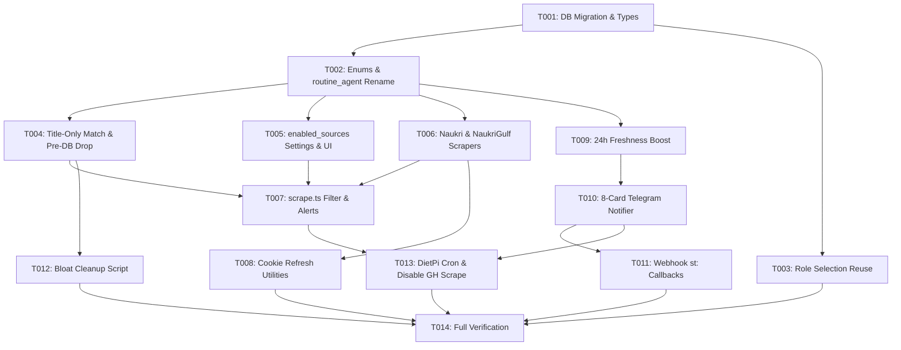

# Execution Plan: Naukri & NaukriGulf Box Pipeline + Role/Telegram Redesign

- **Plan Version:** `1.1.0`
- **Source Spec:** [`docs/features/naukri-box-pipeline/spec.md`](../docs/features/naukri-box-pipeline/spec.md)
- **Target Repo:** `C:\Users\sahid\repos\GitHub\job-scraper`
- **Status:** Locked 12-step plan (`S1`–`S12`), blockers 1 & 2 resolved, `T012` moved to `S11` before `S12`

## 1. Objective

Move daily job scraping to a **08:30 IST DietPi box cron** (residential IP) with GitHub Actions `scrape.yml` schedule disabled, add **Naukri** and **NaukriGulf** as first-class `JobSource`s with cookie-based auth and instant failure alerts, redesign **role pack reuse & title-only pre-DB quality gates** to eliminate dashboard/scoring bloat, add a **`< 24h` freshness boost**, and upgrade **Telegram notifications** to up to 8 interactive per-job cards/day wired to `/api/telegram/webhook`.

## 2. Requirements Summary

| ID | Type | Priority | Summary | Source |
|---|---|---|---|---|
| `REQ-F001` | Functional | Critical | Extend `job_source` enum & `JobSource` with `naukri`, `naukrigulf`; rename `claude_routine` → `routine_agent` | Impl §1 |
| `REQ-F002` | Functional | High | Register `naukri` & `naukrigulf` in `JOB_SOURCES` & `sourceScrapers`; keep `careers_url` & `routine_agent` excluded | Impl §1 |
| `REQ-F003` | Functional | High | Persist `enabled_sources` in `app_settings` (default `["naukri","naukrigulf"]`) + `/settings` checklist card | Impl §2 |
| `REQ-F004` | Functional | High | Filter `sourceScrapers` by `enabled_sources` in `scripts/scrape.ts` | Impl §2 |
| `REQ-F005` | Functional | Critical | Implement `NaukriScraper` & `NaukriGulfScraper` with cookie store, 3–8s jitter, daily page cap, 1–3y filters | Impl §3, US 5 |
| `REQ-F006` | Functional | High | Throw `SourceAuthExpiredError`/`SourceBlockedError` on 401/403/login-redirect/0-job; abort source & alert Telegram | Impl §3, US 6 |
| `REQ-F007` | Functional | Medium | Laptop Chrome CDP/`cookies.json` SCP sync script + phone Termux/SSH cookie refresh shortcut | Impl §3, US 7 |
| `REQ-F008` | Functional | High | Reuse `role_selections` row per pack/role signature in `set_active_role_selection` RPC & `SupabaseRoleRepository` | Impl §4 |
| `REQ-F009` | Functional | Critical | Title-only `jobMatchesRoles` & `buildRoleFilter` with configurable allowlist + denylist (never `description`) | Impl §4 |
| `REQ-F010` | Functional | Critical | Hard-drop title mismatches and `minYears > 3` in `ingestJobs` before DB upsert & AI scoring | Impl §4 |
| `REQ-F011` | Functional | Medium | Idempotent one-time bloat cleanup preserving `job_state` & `applications` rows | Impl §4 |
| `REQ-F012` | Functional | High | Add `< 24h` freshness boost in scoring/ranking for top-8 daily queue selection | Impl §5 |
| `REQ-F013` | Functional | High | DietPi 08:30 IST daily cron/systemd timer (`scrape → score → notify`); keep GH Actions `scrape.yml` disabled | Impl §5 |
| `REQ-F014` | Functional | Critical | Replace single digest dump with up to 8 compact HTML per-job cards/day + `[Apply]`, `[Applied]`, `[Skip]`, `[Closed]` | Impl §6 |
| `REQ-F015` | Functional | Critical | Extend `/api/telegram/webhook` for `st:<action>:<jobId>` (`applied`/`skipped` → `job_state`, `closed` → `is_active=false`, edit card) | Impl §6 |
| `REQ-N001` | Non-Func | High | 3–8s random jitter + strict daily page cap on Naukri/NaukriGulf requests | US 5 |
| `REQ-I001` | Integration | Critical | Cookie store path configurable via env and gitignored; never commit cookies/secrets | Impl §3 |
| `REQ-S001` | Security | Critical | Validate `X-Telegram-Bot-Api-Secret-Token` (`401` on mismatch); idempotent webhook edits | Testing |
| `REQ-C001` | Constraint | High | No auto Easy Apply, no cookie web UI editor, no new bot; keep `scripts/outreach/cdp_helper.py` intact | Out of Scope |

## 3. Constraints, Assumptions & Blockers

### Constraints
- Existing clean/hexagonal feature boundaries (`domain` / `application` / `infrastructure`) must be preserved.
- Settings live in `app_settings` (`SupabaseSettingsRepository.ts`), not a new `settings` table.
- GitHub Actions `scrape.yml` schedule must be disabled; manual `workflow_dispatch` may remain.
- `scripts/outreach/cdp_helper.py` must remain untouched.

### Assumptions
- Postgres 10+ is running on Supabase, supporting `ALTER TYPE job_source RENAME VALUE 'claude_routine' TO 'routine_agent'`.
- `app_settings` is the existing key-value table referenced as "the `settings` table" in the spec.
- `job_statuses` in production matches `supabase/seed.sql` (`New`, `Viewed`, `Interested`, `Applied`, `Not Interested`, `Archived`).

### Resolved Confirmations & Remaining Gate
1. **`st:skipped` status mapping (resolved):** Maps to `Not Interested` (confirmed in `20260810000001_status_dropdown_quick_actions.sql`).
2. **Naukri / NaukriGulf API endpoints (Naukri set; NaukriGulf verify on first run):** Naukri uses `GET https://www.naukri.com/jobapi/v3/search` with headers `appid: "109"`, `systemid: "109"`, `clientid: "d3skt0p"`, `accept: "application/json"`, `User-Agent`, plus session cookies / `nkparam` from HTML search page. Verify NaukriGulf search endpoint from a live session in `S5` (`T006`).
3. **Production DB cleanup approval (`S11` / `T012`, Gate G4):** Moved to `S11` (last step before `S12` final verification/deploy); requires explicit human approval after reviewing `--dry-run` counts.

## 4. Strategy

- **What exists:** `enums.ts`, `SupabaseSettingsRepository` (`app_settings`), `SupabaseRoleRepository` + `set_active_role_selection` RPC, `roleMatch.ts` / `roleFilter.ts` / `ingestJobs.ts`, `sourceScrapers` registry, `computeOverallScore.ts`, `notify.ts` (`sendDigestMvp`), and `/api/telegram/webhook/route.ts`.
- **What changes:**
  1. Schema & enum migration (`T001`) → codebase `routine_agent` rename & `naukri`/`naukrigulf` enum (`T002`).
  2. Role selection deterministic reuse (`T003`), title-only role matching & pre-DB `minYears > 3` drop (`T004`).
  3. `enabled_sources` setting & UI (`T005`), Naukri/NaukriGulf scrapers + cookie store + auth errors (`T006`), `scrape.ts` filtering & alerts (`T007`), cookie refresh scripts (`T008`).
  4. `< 24h` freshness boost (`T009`), 8-card Telegram notifier (`T010`), `st:<action>:<jobId>` webhook handler (`T011`).
  5. Idempotent bloat cleanup script (`T012`), DietPi 08:30 IST cron & GH Actions disable (`T013`), full `npm run verify` (`T014`).
- **Build order:** Sequential along the DAG below; no two tasks touch the same files concurrently.

## 5. Task Order & Dependency Graph

### Locked 12-Step Execution Order (`taskhub`-compatible)
- S1 - DB migration (`T001`: enum rename/add, `enabled_sources`, deterministic `set_active_role_selection`)
- S2 - Enums & role reuse (`T002` + `T003`: `enums.ts`, `FilterBar`, `routine_agent` rename, `SupabaseRoleRepository` selection reuse)
- S3 - Title-only match & pre-DB drop (`T004`: `roleMatch`/`roleFilter`, `minYears > 3` drop in `ingestJobs`)
- S4 - `enabled_sources` settings & UI (`T005`: repository, actions, `/settings` card)
- S5 - Naukri & NaukriGulf scrapers (`T006`: auth/block errors, cookie store, `NaukriScraper`, `NaukriGulfScraper`, registry)
- S6 - Scrape orchestration & alerts (`T007`: `scripts/scrape.ts` `enabled_sources` filter + instant Telegram alerts)
- S7 - Cookie refresh utilities (`T008`: laptop Chrome/SCP sync + phone Termux/SSH shortcut)
- S8 - Freshness boost & 8-card notifier (`T009` + `T010`: `< 24h` boost + 8-card Telegram HTML notifier)
- S9 - Telegram webhook status handler (`T011`: `st:applied`/`st:skipped` → `Not Interested`/`st:closed` + card edit)
- S10 - DietPi 08:30 IST cron & disable GHA (`T013`: systemd timer/cron + disable `scrape.yml` schedule)
- S11 - Bloat cleanup script (`T012`: `--dry-run` / `--execute`, Gate G4 human approval before deploy)
- S12 - Full repo verification (`T014`: `typecheck`, `lint`, `test`, `build`)

## 6. Agent, Tier & Gate Table

| Task | Title | Role | Tier | Gate | Dependencies |
|---|---|---|---|---|---|
| `T001` | DB migration: enum rename/add, `enabled_sources`, deterministic `set_active_role_selection` | `database` | `sr` | `G3` | `—` |
| `T002` | Update `enums.ts`, `FilterBar`, and rename `claude_routine` → `routine_agent` | `backend` | `sr` | `G2` | `T001` |
| `T003` | Deterministic role pack selection reuse in `SupabaseRoleRepository` | `backend` | `sr` | `G2` | `T001` |
| `T004` | Title-only `roleMatch`/`roleFilter` + pre-DB `minYears > 3` drop in `ingestJobs` | `backend` | `sr` | `G2` | `T002` |
| `T005` | `enabled_sources` repository, actions, and `/settings` UI card | `frontend` | `sr` | `G2` | `T002` |
| `T006` | `SourceAuthExpiredError`/`SourceBlockedError`, cookie store, `NaukriScraper` & `NaukriGulfScraper` | `backend` | `sr` | `G3` | `T002` |
| `T007` | `scripts/scrape.ts` `enabled_sources` filtering & instant Telegram alerts | `backend` | `sr` | `G2` | `T004, T005, T006` |
| `T008` | Laptop Chrome/SCP cookie sync script & phone Termux/SSH shortcut | `generalist` | `jr` | `G1` | `T006` |
| `T009` | `< 24h` freshness boost in `computeOverallScore` & unnotified match ordering | `backend` | `sr` | `G2` | `T002` |
| `T010` | 8-card compact HTML Telegram notifier with inline action buttons | `backend` | `sr` | `G2` | `T009` |
| `T011` | `/api/telegram/webhook` `st:<action>:<jobId>` handler & in-place card edit | `backend` | `sr` | `G3` | `T010` |
| `T012` | Idempotent one-time bloat cleanup script (`--dry-run` / `--execute`) | `database` | `sr` | `G4` | `T004` |
| `T013` | DietPi 08:30 IST cron/systemd timer & disable `scrape.yml` schedule | `generalist` | `jr` | `G1` | `T007, T010` |
| `T014` | Full repo verification (`typecheck`, `lint`, `test`, `build`) | `tester` | `sr` | `G2` | `T003, T008, T011, T012, T013` |

## 7. Verification Strategy

- **Unit & Integration Tests (Vitest):** Repository doubles and HTTP fixture mocks per existing repo conventions (`MyCareersFutureScraper.test.ts`, `ingestJobs.test.ts`, `helpers.test.ts`).
- **Static Gates:** `npm run typecheck`, `npm run lint`, `npm run test`, `npm run build`, `npm run check:service-role-boundary`.
- **Judge Policy:** Independent judge reviews every task's diff and test output against its `AC-*` checklist before marking `accepted`.
- **Pro-Tier Escalation:** Only on `G3`–`G4` after an independent judge returns `FAIL` with specific evidence (non-transient). `G4` (`T012` execution) requires mandatory human approval.

## 8. Risks & Mitigations

| Risk | Impact | Mitigation |
|---|---|---|
| Naukri/NaukriGulf API/HTML changes or anti-bot blocks | High | 3–8s jitter, daily page cap, `SourceAuthExpiredError`/`SourceBlockedError` immediate abort + Telegram alert |
| `st:skipped` maps to wrong `job_statuses` label | Medium | Block `T011` on explicit confirmation of target status label (`Not Interested` vs new `Skipped`) |
| `routine_agent` rename misses a string literal or test | Medium | Full repo `Select-String` / `tsc --noEmit` / `vitest run` in `T002` & `T014` |
| Bloat cleanup deletes active user-tracked jobs | Critical | `T012` is `G4`, defaults to `--dry-run`, explicitly excludes `job_state` & `applications` |

## 9. Definition of Done

1. All tasks `T001`–`T014` reach `accepted` in `.agent/STATE.json` with `judge_passed` events in `.agent/ledger/events.jsonl`.
2. `npm run verify` (`typecheck && lint && test && build`) passes with zero errors.
3. No real cookies, tokens, or secrets committed to the repository.

## 10. Change-Control Rules

- Replan only by bumping `Plan Version`, recording reason in `STATE.json` and `events.jsonl`, listing affected tasks, and preserving already-accepted work.
- Never silently edit completed tasks or advance dependencies past a `FAIL` or `BLOCKED` task.

## 11. Traceability Matrix

| Requirement | Tasks | Validation |
|---|---|---|
| `REQ-F001` | `T001`, `T002` | `AC-001-1`, `AC-002-1` |
| `REQ-F002` | `T002` | `AC-002-2`, `AC-002-3` |
| `REQ-F003` | `T001`, `T005` | `AC-001-2`, `AC-005-1`, `AC-005-2` |
| `REQ-F004` | `T007` | `AC-007-1` |
| `REQ-F005` | `T006` | `AC-006-1`, `AC-006-2` |
| `REQ-F006` | `T006`, `T007` | `AC-006-3`, `AC-007-2` |
| `REQ-F007` | `T008` | `AC-008-1`, `AC-008-2` |
| `REQ-F008` | `T001`, `T003` | `AC-001-3`, `AC-003-1` |
| `REQ-F009` | `T004` | `AC-004-1`, `AC-004-2` |
| `REQ-F010` | `T004` | `AC-004-3` |
| `REQ-F011` | `T012` | `AC-012-1`, `AC-012-2` |
| `REQ-F012` | `T009` | `AC-009-1`, `AC-009-2` |
| `REQ-F013` | `T013` | `AC-013-1`, `AC-013-2` |
| `REQ-F014` | `T010` | `AC-010-1`, `AC-010-2` |
| `REQ-F015` | `T011` | `AC-011-1`, `AC-011-2` |
| `REQ-N001` | `T006` | `AC-006-2` |
| `REQ-I001` | `T006`, `T008` | `AC-006-4`, `AC-008-3` |
| `REQ-S001` | `T011`, `T014` | `AC-011-3`, `AC-014-1` |
| `REQ-C001` | `T013`, `T014` | `AC-013-1`, `AC-014-2` |
